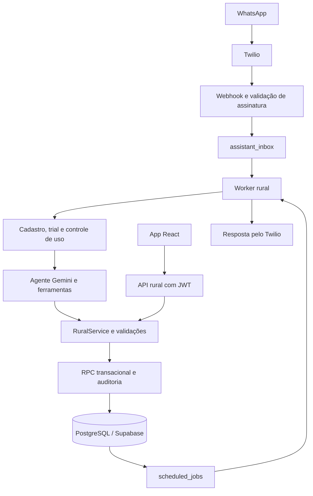

# AGGI — documentação técnica para desenvolvimento

Referência: código local consultado em **20/10/2026**. Este documento descreve a implementação encontrada; não confirma a versão publicada, as migrações aplicadas ou as flags de produção. A elaboração foi documental, sem executar os testes ou acessar credenciais de produção.

## 1. Resumo técnico

O AGGI combina uma API **Node.js/Express**, um app **React/TypeScript** e uma assistente no WhatsApp chamada **Lida**. O **Supabase** fornece PostgreSQL, autenticação e armazenamento. O **Twilio** recebe e envia mensagens e SMS; o **Gemini** interpreta texto, foto e áudio e pode chamar ferramentas operacionais. A assinatura do AGGI integra o **Asaas**.

O ponto central da arquitetura é o domínio rural em `src/rural/`: o app e a Lida usam os mesmos serviços, validações e dados. O modelo de IA interpreta pedidos; autorização, cálculos, saldos e persistência ficam no servidor e no banco.

O escopo atual é agricultura e criação de animais. O nome `CampoAI` permanece no diretório e em identificadores técnicos; a marca do produto é **AGGI**. Módulos esportivos estão fora do escopo vigente.

## 2. Stack e execução

- **Backend:** JavaScript com ES modules, Express 4 e execução por `src/index.js`.
- **Frontend principal:** React 19, TypeScript, Vite 6 e React Router 7, em `app/`.
- **Frontend complementar:** HTML/CSS/JavaScript em `public/`, para planos, login legado, portal do cliente, documentos legais e admin.
- **Banco/Auth/Storage:** Supabase; operações privilegiadas usam `service_role` exclusivamente no backend.
- **IA:** SDK `@google/generative-ai`; Ollama é uma alternativa para texto no caminho legado, não o provider de ferramentas operacionais.
- **Mensageria:** Twilio WhatsApp e SMS.
- **Pagamento:** API e webhook Asaas.
- **PDF:** PDFKit e Storage privado com URLs assinadas.
- **Jobs:** `node-cron`, inbox persistente e jobs armazenados no PostgreSQL.
- **Observabilidade:** logs de execução, identificadores de requisição e Sentry opcional.
- **Android:** projeto Capacitor 8 em `app/android/`, compartilhando o build React.

O `engines` do backend declara Node.js `>=18`. Isso não estabelece, sozinho, a versão adequada para todas as dependências do app e do Capacitor; conferir os requisitos dessas ferramentas e os lockfiles ao preparar o ambiente.

## 3. Mapa do repositório

Os caminhos abaixo são relativos a `CampoAI/`.

```text
src/
  index.js                 Inicialização HTTP, jobs e encerramento
  app.js                   Express, middlewares, rotas e arquivos web
  controllers/             Adaptação de requisições e respostas
  routes/                  Contratos HTTP por área
  middleware/              JWT, admin, assinatura Twilio e rate limiting
  services/                Cadastro, IA legada, billing, uso e integrações
  rural/                   Domínio rural, schemas, validação e persistência
  ai/
    agent/                 Loop do agente e provider Gemini
    context/               Contexto limitado a dados acessíveis ao usuário
    tools/                 Catálogo e execução das ferramentas
    policies/              Intenção, escopo, respostas e confirmações
  jobs/                    Worker rural e crons
  models/                  Cliente Supabase e modelo de usuário
  lib/                     Integrações de infraestrutura, como Sentry
  swagger/                 Especificação OpenAPI
app/
  src/                     App React, rotas, telas e cliente HTTP
  android/                 Projeto nativo Capacitor
  vite.config.ts           Build, base URL e proxy local
  capacitor.config.ts      Configuração do pacote Android
public/                    Portais e páginas complementares
supabase/                  Schema histórico e migrações numeradas
test/                      Testes Node e suporte PostgreSQL/PGlite
scripts/                   Verificações, testes de UI, preview e workers
docs/                      Produto, operação, integrações e publicação
api/index.js               Entrada alternativa para Vercel
railway.json               Build, start e healthcheck do Railway
```

A landing `useaggi.com` é hospedada separadamente. Os documentos citam um repositório `CampoAILanding`, que não está presente na raiz deste workspace consultado.

## 4. Arquitetura e caminhos de execução



O diagrama mostra o caminho operacional com `AGENT_TOOLS_ENABLED=true`. Com essa flag desligada, o webhook segue o fluxo legado de `incomingMessageService.js`, sem a mesma entrada pela inbox operacional.

### 4.1 Inicialização

[`src/index.js`](../src/index.js) carrega o ambiente, inicializa Sentry, cria o Express e abre a porta. Depois inicia o worker rural e os crons de notícias e expiração do trial. SIGINT/SIGTERM encerram os agendamentos e o servidor.

[`src/app.js`](../src/app.js) concentra montagem de rotas, parsing, CORS, Helmet e entrega do frontend. O parsing `urlencoded` é necessário porque o Twilio envia formulários, não apenas JSON.

### 4.2 Mensagem WhatsApp

1. `POST /webhook/whatsapp/twilio` passa por rate limiting e validação de assinatura.
2. `twilioInboundController.js` ignora ecos/callbacks de status, normaliza texto/mídia e monta o payload.
3. Com o agente ativo, `enqueueRuralMessage()` persiste o `MessageSid` na `assistant_inbox` antes de responder HTTP 200. O SID deduplica a entrada.
4. O worker faz claim no banco e chama `processIncomingMessage()`.
5. O serviço verifica cadastro e acesso de uso, escolhe o caminho operacional ou legado e gerencia resposta, histórico e consumo.
6. O agente usa ferramentas para consultar ou gravar. A resposta precisa corresponder ao resultado efetivo da operação.

Arquivos de entrada: [`whatsappRoutes.js`](../src/routes/whatsappRoutes.js), [`twilioInboundController.js`](../src/controllers/twilioInboundController.js), [`incomingMessageService.js`](../src/services/incomingMessageService.js) e [`ruralWorker.js`](../src/jobs/ruralWorker.js).

### 4.3 Gravação pelo app

1. `app/src/api.ts` obtém a sessão do Supabase e envia `Authorization: Bearer <token>`.
2. `ruralRoutes.js` exige usuário Auth vinculado a `public.users` e habilitação do agente.
3. A rota cria um `RuralService` com usuário autenticado e chave de origem da solicitação.
4. O domínio valida entidade, campos, propriedade, relacionamentos e regras específicas.
5. O repositório chama `apply_rural_action`, que aplica mudanças e auditoria em transação.

Esse caminho não precisa chamar Gemini para registrar, consultar ou corrigir dados manualmente.

## 5. Persistência e modelo de dados

### 5.1 Grupos de entidades

- **Conta e comercial:** `users`, `organizations`, `organization_seats`, `plan_catalog` e `product_plans`.
- **Estrutura rural:** `farms`, `farm_members`, `fields`, `field_aliases`, `crop_seasons` e `field_cycles`.
- **Operação:** `farm_operations`, `farm_expenses`, `farm_tasks`, `inventory_items` e `inventory_movements`.
- **Atividades diversificadas:** `farm_activities`, `production_units` e `production_events`.
- **Financeiro do produtor:** `farm_sales` e `sale_payments`. Esses registros não são a cobrança da assinatura AGGI.
- **Execução e acompanhamento:** `assistant_inbox`, `assistant_actions`, `assistant_context`, `assistant_memories`, `scheduled_jobs`, alertas, anexos e cache climático.

Uma propriedade pode ter atividades diferentes. As fichas de produção representam animais, lotes, áreas, canteiros, viveiros, colmeias ou instalações, conforme o perfil da atividade.

### 5.2 Regras que precisam ser preservadas

- **Propriedade:** leitura e escrita validam o titular; referências não podem apontar para registros de outra fazenda.
- **Persistência:** sucesso na conversa não equivale a sucesso no banco. Confirmar gravações com o resultado do domínio.
- **Idempotência:** reaproveitar a chave de uma tentativa idêntica; uma nova ação precisa de outra chave.
- **Transação:** efeitos relacionados, como consumo e baixa de estoque, devem permanecer atômicos.
- **Auditoria:** correções preservam histórico; anulações não devem apagar a trilha.
- **Estoque:** movimentações e compensações determinam saldo; não alterar o saldo isoladamente para corrigir um evento.
- **Recebimento:** não ultrapassar o valor devido. Corrigir recebimentos antes de reduzir/cancelar venda já paga.
- **Unidades:** não converter kg, unidades, sacos ou outras medidas por suposição. Totais incompatíveis ficam separados.
- **Datas:** filtros usam `from` inclusivo e `to` exclusivo. Tarefas respeitam o fuso da propriedade.
- **Paginação:** resumo e listas recentes não representam automaticamente o histórico completo.

Referências: [`service.js`](../src/rural/service.js), [`repository.js`](../src/rural/repository.js), [`schemas.js`](../src/rural/schemas.js), [`agroCatalog.js`](../src/rural/agroCatalog.js), [`agroValidation.js`](../src/rural/agroValidation.js) e [`time.js`](../src/rural/time.js).

### 5.3 Migrações

- **017–020:** sincronização de catálogo, trial, legado e vínculo com Supabase Auth.
- **021:** base do domínio rural.
- **022:** transações e mecanismos de execução rural.
- **023:** evolução de follow-ups e infraestrutura operacional.
- **024:** atividades, fichas, eventos, vendas e recebimentos agro.
- **025:** oferta 2026-10, termos contratados e controle de franquia.

Verificar o histórico do banco antes de aplicar arquivos. `schema.sql` é o bootstrap histórico, não um mecanismo para atualizar produção. Novas instalações também precisam das migrações complementares exigidas pela versão. Não editar migrações já publicadas; mudanças novas recebem migração nova.

## 6. Autenticação, autorização e contratos HTTP

### 6.1 Fronteiras de acesso

- **Cliente web:** JWT validado pelo Supabase Auth. `requireCustomerAuth` autentica; `requireLinkedCustomer` também exige vínculo com `public.users`.
- **Admin:** JWT válido e e-mail incluído em `ADMIN_EMAILS`.
- **WhatsApp:** identidade deriva da requisição assinada pelo Twilio e do telefone normalizado, não de um `user_id` informado pelo modelo.
- **API rural:** além do vínculo, exige flag do agente e valida titularidade da fazenda no domínio.
- **Banco:** `SUPABASE_SERVICE_ROLE_KEY` fica no servidor. O app recebe configuração pública e a chave anon para autenticação.

Assento comercial em uma organização não concede automaticamente acesso compartilhado aos dados de fazenda. `farm_members` prepara evolução do modelo; o acesso rural observado está baseado no titular. Habilitação por flag também não é equivalente a uma regra comercial de plano: conferir ambas ao alterar permissões ou entitlements.

### 6.2 Rotas principais

**Públicas e operacionais**

- `GET /health`: disponibilidade HTTP do serviço; não verifica todas as integrações.
- `GET /api-docs` e `GET /openapi.json`: documentação de API. Confrontar com os arquivos de rotas ao alterar contratos.
- `GET /api/plans`: catálogo público.
- `GET /api/noticias`: notícias com cache.
- `POST /webhook/whatsapp/twilio`: entrada WhatsApp assinada.
- `POST /webhook/asaas`: eventos Asaas.

**Cadastro e cliente**

- `POST /api/signup/otp/send` e `/otp/verify`: verificação SMS.
- `POST /api/signup/complete`: conclusão do cadastro com autenticação.
- `GET /api/customer/config`: configuração pública do cliente.
- `GET /api/customer/me` e `/workspace`: sessão e contexto da conta.
- `POST /api/customer/link-phone`, `PATCH /profile`, `POST /seats` e `DELETE /seats`: vínculo, perfil e números, com as verificações correspondentes.

**Rural — prefixo `/api/rural`**

- `GET/POST /farms` e `PATCH /farms/:farmId`.
- `GET /farms/:farmId/summary`, `/dashboard`, `/activity` e `/weather`.
- `GET /farms/:farmId/expenses/summary`.
- `GET /agro/catalog` e `/farms/:farmId/agro/overview`.
- `GET/POST /farms/:farmId/:entity`.
- `GET/PATCH /farms/:farmId/:entity/:recordId`.
- `GET /farms/:farmId/:entity/:recordId/history`.
- `POST /farms/:farmId/report`.

`:entity` passa pelo catálogo/schema permitido; a rota genérica não libera acesso arbitrário a tabelas. Há restrições específicas, como cancelamento de tarefa pelo app: a rota orienta confirmar pelo WhatsApp.

**Billing**

- `POST /api/billing/otp/send` e `/otp/verify`.
- `POST /api/billing/checkout`: fluxo autenticado de checkout.
- `POST /api/billing/requests`: solicitação autenticada de assinatura.
- `POST /api/billing/asaas/subscribe`: integração protegida pelo segredo `x-ag-checkout-secret`, conforme `billingController.js`; não colocar esse segredo no frontend.

O webhook JSON `POST /webhook/whatsapp` exige admin quando o agente está ativo ou `NODE_ENV=production`; telefone no JSON não autentica o usuário.

### 6.3 Respostas e repetição

As rotas rurais retornam, em geral, `{ "ok": true, "data": ... }`. O middleware global de erros retorna `ok`, `error`, `code` e `requestId`. Alguns middlewares/controllers usam envelopes próprios; não assumir que todos os endpoints têm o mesmo contrato.

O Express adiciona `X-Request-ID`. A API rural responde com `Cache-Control: no-store`. Para escrita, enviar `Idempotency-Key`; a rota valida seu formato. `createWriteRequest()` no app mantém a chave enquanto a tentativa e o conteúdo continuam iguais.

## 7. Agente de IA e ferramentas

[`runAgent.js`](../src/ai/agent/runAgent.js) monta contexto, aplica regras determinísticas, seleciona ferramentas e conduz as rodadas com o provider. Há caminhos diretos para determinados pedidos simples, além da execução pelo modelo.

Limites presentes no código consultado:

- Até **8 rodadas** de modelo.
- Até **24 chamadas de ferramenta** no ciclo.
- Deadline global de **240 segundos**, com chamadas limitadas pelo tempo restante.
- Até **8 turnos recentes** de histórico, com truncamento por mensagem.

O contexto persistido entra como dados, separado das instruções de sistema. O usuário efetivo é definido pelo servidor. Ferramentas executam pelo domínio rural; não criar acesso administrativo ou gravação direta no banco por sugestão do modelo.

Para mudar uma capacidade operacional, conferir em conjunto:

1. Contrato e validação em `src/rural/`.
2. Ferramenta em `src/ai/tools/catalog.js` ou `agroTools.js`.
3. Contexto em `src/ai/context/buildContext.js`.
4. Políticas e recibos em `src/ai/policies/`.
5. Contrato HTTP e interface, se a operação também existir no app.

As seis ferramentas agro compartilhadas consultam contratos, listam, buscam, resolvem fichas, gravam e resumem registros. A especialização fica no catálogo e nas validações por entidade/perfil, evitando duplicar um conjunto inteiro de ferramentas por espécie.

Alterar apenas o prompt não implementa uma regra de negócio. Uma resposta que afirma gravação precisa estar apoiada no resultado da ferramenta. Cálculos financeiros e de saldo devem continuar determinísticos.

## 8. App web e Android

- [`app/src/main.tsx`](../app/src/main.tsx): inicialização React, ErrorBoundary e seleção do router.
- [`app/src/App.tsx`](../app/src/App.tsx): composição principal, sessão e navegação.
- [`app/src/api.ts`](../app/src/api.ts): sessão Supabase, Bearer token, timeout, erros e idempotência.
- [`app/src/routes.ts`](../app/src/routes.ts): parsing e construção de caminhos de fazenda e registro.
- `Dashboard.tsx`, `useDashboard.ts` e `useFarmData.ts`: resumo e carregamento de dados.
- `AgroWorkspace.tsx`: interface das atividades/fichas agro.
- `RecordPage.tsx`, `RecordDialog.tsx`, `RecordDetails.tsx` e `RecordHistory.tsx`: consulta, edição e histórico de registros.
- `Signup.tsx`: cadastro React.
- `farmTime.ts`: apoio ao tratamento de datas/fuso no cliente.

Na web, o app usa BrowserRouter e caminhos na raiz: `/`, `/cadastro` e `/:farmId/...`. No build nativo, usa HashRouter e assets relativos. `src/app.js` redireciona os antigos `/app/*` com 308 e preserva a query string; rotas inexistentes de API/webhook não devem cair no HTML da SPA.

`VITE_API_BASE_URL` vazio mantém mesma origem na web. No Android, apontar para o backend HTTPS acessível pelo dispositivo. O Capacitor usa `webDir: dist`; a interface vem dos assets empacotados, não de um site remoto carregado como tela.

O app trata falha de confirmação de escrita e mantém dados do formulário em fluxos específicos. Isso não equivale a uma fila offline persistente. Permissões de equipe, sincronização offline e validação em aparelho permanecem frentes de evolução documentadas.

## 9. Cadastro, assinatura e consumo

O cadastro combina Supabase Auth, confirmação do telefone por SMS e vínculo em `users`. O acesso WhatsApp depende de cadastro concluído; o usuário não precisa manter uma sessão web aberta para conversar.

O trial padrão termina em **14 dias ou 10 análises**, o que ocorrer primeiro. Os limites são configuráveis no servidor.

Na oferta documentada 2026-10, as franquias mensais são 40, 100, 250 e 400 análises para Essencial, Starter, Team e Business. Os valores de referência estão em [`PRICING_2026_10.md`](PRICING_2026_10.md); usar o catálogo e os termos contratados no código, sem reproduzir valores fixos em novos fluxos.

Regras comerciais relevantes para manutenção:

- Um pedido concluído com IA conta uma análise; falhas e respostas sem IA não devem ser cobradas como análise concluída.
- A assinatura de equipe compartilha consumo na linha do titular, com reserva transacional.
- `subscriptionUsageService.js` chama RPCs de reserva e liquidação; a migração 025 implementa a infraestrutura correspondente.
- Reservas abandonadas expiram conforme a regra da migração; a documentação registra 30 minutos.
- `users.subscription_terms` preserva os termos contratados; atualizar catálogo não deve sobrescrever automaticamente contratos anteriores.
- A franquia mensal usa o calendário definido para `America/Sao_Paulo`, mesmo na contratação anual.
- Vendas/recebimentos registrados pelo produtor não geram cobranças Asaas ou emissão fiscal.

Fontes: [`subscriptionUsageService.js`](../src/services/subscriptionUsageService.js), [`asaasSubscriptionService.js`](../src/services/asaasSubscriptionService.js), [`planCatalogService.js`](../src/services/planCatalogService.js) e [`productPlanRepository.js`](../src/services/productPlanRepository.js).

`asaasClient.js` só seleciona sandbox quando `ASAAS_SANDBOX` é exatamente `true`; sem isso, o destino é produção. Configurar sandbox explicitamente em desenvolvimento. Configurar também `ASAAS_WEBHOOK_TOKEN`: o controller atual só compara o token recebido quando a variável está preenchida.

## 10. Worker, lembretes e resultados incertos

O processo Node inicia o worker rural a cada **15 segundos** quando agente ou lembretes estão habilitados. Também existe `npm run worker:rural` para execução pelo fluxo externo previsto na documentação.

O claim da inbox e dos jobs ocorre no PostgreSQL. Locks, tokens e funções de claim coordenam execução; o booleano `running` em memória evita sobreposição apenas dentro do mesmo processo.

Para lembretes, a sequência principal é:

```text
pending → locked → sending → completed
                         ↘ uncertain, quando o resultado do envio é desconhecido
```

`completed` registra aceitação pelo Twilio, não leitura ou entrega comprovada ao aparelho. Banco e mensageria não compartilham transação. Mensagem ou job em `uncertain` precisa de conferência das ações e do SID no provider antes de reprocessar; não adicionar retry automático indiscriminado.

Lembretes dependem de `REMINDERS_ENABLED`, template aprovado em `REMINDER_CONTENT_SID` e worker operante. Desligar o agente não é justificativa para interromper compromissos de lembretes já assumidos.

## 11. Configuração de ambiente

Usar `.env.example`, `.env.rural.example` e os guias de integração como base. Os exemplos não contêm necessariamente todas as variáveis das funcionalidades posteriores; o código é a referência para nomes e defaults. Não versionar segredos reais.

**Base e autenticação:** `PORT`, `NODE_ENV`, `SUPABASE_URL`, `SUPABASE_SERVICE_ROLE_KEY`, `SUPABASE_ANON_KEY`, `ADMIN_EMAILS` e `PUBLIC_APP_URL`.

**Mensageria e cadastro:** `TWILIO_ACCOUNT_SID`, `TWILIO_AUTH_TOKEN`, `TWILIO_WHATSAPP_FROM`, `TWILIO_SMS_FROM`, `SIGNUP_URL`, `FREE_TRIAL_DAYS`, `FREE_USAGE_LIMIT` e os Content SIDs dos templates usados.

**IA:** `GEMINI_API_KEY`, opções do modelo e, para o caminho legado opcional, `LLM_TEXT_PROVIDER`, `OLLAMA_BASE_URL` e `OLLAMA_MODEL`.

**Assinatura:** `ASAAS_API_KEY`, `ASAAS_SANDBOX`, `ASAAS_WEBHOOK_TOKEN`, `ASAAS_CHECKOUT_API_SECRET` e `PAYWALL_URL`.

**Complementos:** `RESEND_API_KEY`, configuração de boas-vindas por e-mail, `SUPABASE_REPORTS_BUCKET`, `OPEN_METEO_API_KEY` e `SENTRY_DSN`, conforme o recurso.

### Flags rurais

O mapeamento central está em [`src/rural/features.js`](../src/rural/features.js). As flags só ativam quando o valor é a string `true` e há usuário com ID.

- `AGENT_TOOLS_ENABLED`: caminho operacional e acesso à API rural.
- `AGRO_MODULES_ENABLED`: atividades e fichas dos módulos agro.
- `EXPENSES_ENABLED`: financeiro.
- `INVENTORY_ENABLED`: estoque.
- `REMINDERS_ENABLED`: lembretes e envio de jobs.
- `FARM_MEMORY_ENABLED`: memória confirmada.
- `WEATHER_ENABLED`: clima.
- `OCCURRENCES_ENABLED`: ocorrências.
- `FARM_MEDIA_ENABLED`: mídia rural.
- `FARM_REPORTS_ENABLED`: relatório rural estruturado.

`REPORTS_ENABLED` controla o PDF de conversa e é distinto de `FARM_REPORTS_ENABLED`. Antes de ativar flags, garantir migrações, providers, buckets e templates exigidos.

## 12. Setup local

Executar a partir de `CampoAI/`, com Node/npm compatíveis e um projeto Supabase de desenvolvimento com schema/migrações alinhados à versão.

```powershell
# Dependências do backend e do frontend
npm ci
npm --prefix app ci

# Preserva um .env já existente
if (-not (Test-Path .env)) { Copy-Item .env.example .env }
```

Preencher o ambiente com credenciais de desenvolvimento. O código não provisiona automaticamente um Supabase local ao executar `npm run dev`.

### Atenção às portas

O backend usa **3001** quando `PORT` não é definido. O proxy em `app/vite.config.ts` aponta para **3000**. Para trabalhar com Vite sem alterar código, iniciar o backend na porta esperada pelo proxy:

```powershell
# Terminal 1, em CampoAI/
$env:PORT = "3000"
$env:MOCK_WHATSAPP = "true"
$env:MOCK_EMAIL = "true"
$env:MOCK_LLM = "true"
$env:ASAAS_SANDBOX = "true"
npm run dev
```

```powershell
# Terminal 2, também em CampoAI/
npm --prefix app run dev
```

- API: `http://localhost:3000/health`.
- Swagger: `http://localhost:3000/api-docs`.
- Vite: `http://localhost:5173`.

Os mocks não substituem todas as integrações. Em particular, o agente operacional usa `GeminiAgentProvider`; não assumir que `MOCK_LLM=true` bloqueia chamadas desse caminho. Nos testes de agente, o provider é controlado/injetado. Com o agente desligado, a API rural também fica indisponível; para testar o app rural, preparar o banco de desenvolvimento e habilitar as flags necessárias conscientemente.

Cadastros com OTP, e-mail, Storage e pagamentos têm requisitos próprios. Conferir Supabase Auth, URLs de retorno e os guias de integração antes de usar o fluxo completo.

## 13. Verificação por tipo de mudança

Os comandos abaixo são orientações para o desenvolvedor; não foram executados na elaboração deste documento.

```powershell
# Suíte Node: domínio rural, agro, dashboard, datas e preços
npm test

# Build web: usa o script de build definido na raiz
npm run build

# Interface: executar os que cobrem a mudança
npm run test:app-ui
npm run test:agro-ui
npm run test:dashboard-ui
npm run test:pricing-ui
npm run test:routes-ui
npm run test:domains

# Cadastro e checkout, quando afetados
npm run test:signup-flow
npm run test:checkout-ui

# Assets nativos, quando afetados
npm --prefix app run build:native
```

Os testes Node usam PostgreSQL isolado via PGlite e suporte em `test/support/database.js`. Isso valida contratos e migrações em ambiente local; não reproduz concorrência, latência e integrações de produção. Os scripts de navegador têm requisitos próprios, incluindo Playwright; consultar o script e as dependências do ambiente antes de executar.

Mudanças em escrita precisam cobrir sucesso, falha antes/depois da gravação, repetição, isolamento entre propriedades, datas/fuso e preservação de saldos. Para interface, conferir também troca de propriedade, sessão expirada, rede indisponível e atualização direta de rota.

Scripts como `verify:integrations`, `confirm:migrations`, `smoke:deploy` e `validate:funnel` consultam ambientes/integrações conforme a configuração. Não tratá-los como testes isolados sem conferir seus alvos e efeitos.

## 14. Publicação e observabilidade

O destino documentado principal é Railway para backend e React no mesmo serviço:

```text
build:       npm run build
start:       npm start
healthcheck: /health
```

O serviço deve partir da raiz `CampoAI/`, não de `app/`: o Express executa o backend e entrega `app/dist`. O build gerado não deve ser versionado como substituto de configurar o build no deployment.

Domínios previstos:

- `useaggi.com`: landing separada.
- `app.useaggi.com`: app React e API.
- `planos.useaggi.com`: opção de hostname de checkout no mesmo backend, quando configurado.

`PUBLIC_APP_URL`, `SIGNUP_URL` e `PAYWALL_URL` coordenam os links. O frontend web usa a mesma origem; as sessões de navegador não são automaticamente compartilhadas entre subdomínios. Retornos Auth precisam estar na allowlist do Supabase, sem transportar tokens como atalho na query string.

Antes de publicar, conferir migrações compatíveis, branch/commit conectado ao serviço, build React, variáveis e URLs dos webhooks. A oferta 2026-10 exige a migração 025 antes de receber tráfego dessa revisão; o procedimento coordenado está em `PRICING_2026_10.md`.

A entrada Vercel não substitui um processo persistente de jobs. Em execução serverless, seguir `OPERATIONAL_ROLLOUT.md` para worker/scheduler externo; não depender de tarefas em memória após a resposta HTTP.

Para diagnóstico:

- Usar `requestId`/`X-Request-ID` para correlacionar falhas HTTP.
- Conferir `correlation_id`, ferramentas e duração nos logs do agente.
- Conferir inbox, auditoria e estado de jobs para distinguir gravação de envio.
- Conferir SID no Twilio quando houver resultado incerto.
- Sentry é inicializado quando `SENTRY_DSN` está configurado.

A configuração atual de `app.js` usa `cors()` sem allowlist e desativa CSP no Helmet. Não interpretar a presença desses middlewares como uma política já restrita de origens/conteúdo; qualquer mudança nessa área precisa considerar landing, portais e carregamento do app.

## 15. Pontos de atenção e trabalho ainda pendente

1. **Documentação histórica:** `README.md` e `DEV_WORKFLOW.md` contêm trechos de fases anteriores, incluindo nomes antigos, cobrança descrita como futura e jornadas anteriores do cadastro. Priorizar código, `PRODUCT.md`, `DOMAINS.md` e os rollouts específicos para o comportamento vigente.
2. **Portas de desenvolvimento:** alinhar backend e proxy Vite como descrito acima.
3. **Exemplos de ambiente incompletos:** `.env.rural.example` não lista `AGRO_MODULES_ENABLED`; o mapeamento atual está em `features.js`.
4. **Equipe:** números compartilhados de assinatura e permissões de fazenda são problemas distintos; não liberar dados rurais apenas por existir um assento comercial.
5. **Offline/Android:** build de assets não comprova teste em aparelho, instalação assinada ou sincronização offline persistente.
6. **Financeiro rural:** totais de venda/recebimento/despesa não implementam automaticamente lucro, rateio ou contabilidade fiscal.
7. **Zootecnia:** não há deduplicação universal entre produção individual e lote, nem protocolos clínicos/reprodutivos completos.
8. **Custo e validação real:** evidência local não mede custo por ação no Gemini, entendimento de todas as frases ou utilidade em todas as operações rurais.
9. **Entitlements:** os limites rurais fixos em `farmEntitlements()` não são, por si, uma matriz completa de permissões por plano. Conferir o modelo antes de ampliar regras comerciais.

## 16. Roteiro para a primeira alteração

1. Ler `PRODUCT.md` para confirmar escopo e terminologia.
2. Reproduzir a jornada no ambiente de desenvolvimento e identificar o ponto de entrada.
3. Localizar a regra no domínio; conferir se app e Lida precisam do mesmo comportamento.
4. Se mudar persistência, criar migração nova e manter auditoria/idempotência/isolamento.
5. Ajustar contrato HTTP, ferramenta de IA e interface apenas nas superfícies afetadas.
6. Executar testes e build proporcionais à alteração.
7. Atualizar exemplos de configuração e documentação do fluxo alterado.
8. Publicar seguindo a ordem de banco, backend e frontend exigida pela mudança; conferir ambiente de destino.

### Leitura complementar

- [Produto e jornadas](../PRODUCT.md).
- [Identidade visual](../DESIGN.md) — para reproduzir a landing atual, conferir também os tokens publicados e o app.
- [Rollout operacional](OPERATIONAL_ROLLOUT.md).
- [Módulos agro e limites](AGRO_MODULES_ROLLOUT.md).
- [Escopo modular vigente](AGRO_MODULAR_PLAN.md).
- [Oferta, termos e migração de preços](PRICING_2026_10.md).
- [Domínios, SPA, autenticação e build](DOMAINS.md).
- [Integrações](INTEGRATIONS_SETUP.md).
- [Checklist de produção](PRODUCTION_CHECKLIST.md).

A apresentação institucional permanece em `../../apresentacao-aggi/`; este guia é o material técnico complementar para manutenção do código.
